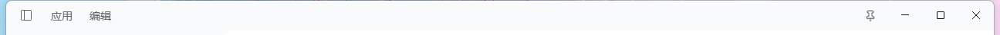
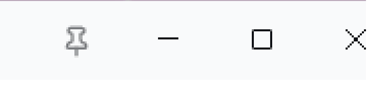
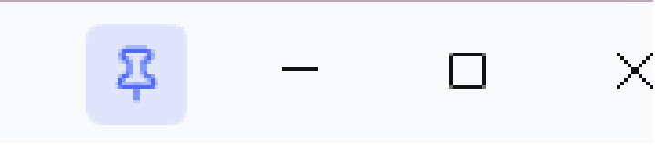

# dsh-always-on-top

[](https://www.npmjs.com/package/dsh-always-on-top)

[English](README.md) | 中文

> 给 DSH Desktop 加一个小图钉：点一下，窗口永远在最上层；再点一下，取消。

一个极小的 DSH 插件（host 路由 + 一个按钮的客户端脚本），没有任何第三方依赖，不需要构建步骤。



未置顶 / 已置顶：




```
┌──────────────────────────────────────────────┐
│  应用  编辑                        📌   ─ □ ✕ │
├──────────────────────────────────────────────┤
```

## 功能

- **标题栏右上角一枚图钉**，就在 Windows 最小化按钮左边，不挡任何原有按钮
- 点击切换「始终置顶」（Win32 `WS_EX_TOPMOST`）
- 置顶后图标变蓝，鼠标悬停提示「已置顶，点击取消」
- **记住状态**：退出应用前是置顶的，下次启动会自动恢复置顶
- 非 Windows / 非 DSH Desktop 环境自动隐藏，不会出现无效按钮

## 安装

包已经发布到 npm：`dsh-always-on-top`。

### 从 npm（推荐）

```powershell
# DSH CLI（web / tui profile）
dsh plugin --profile web add dsh-always-on-top

# 直接装进 desktop profile
pnpm -C "$env:USERPROFILE\.dsh\profiles\desktop" add dsh-always-on-top

# 然后把 "dsh-always-on-top" 加进 profile 的 dsh.profile.bundles，重启应用
```

> DSH Desktop 的 `desktop` profile 被 Electron 独占，CLI 会拒绝操作它；
> 这种情况下用下面的手动方式，或在应用内「设置 → 插件 → 添加插件」里安装。

### 从 GitHub

```powershell
pnpm -C "$env:USERPROFILE\.dsh\profiles\desktop" add "github:Suibianlilili/dsh-always-on-top"

# 然后把 "dsh-always-on-top" 加进 profile 的 dsh.profile.bundles，重启应用
```

### 手动安装

```powershell
# 1. 把包装进 profile
pnpm -C "$env:USERPROFILE\.dsh\profiles\desktop" add dsh-always-on-top

# 2. 把包名加进 profile 的 package.json -> dsh.profile.bundles
#    "dsh-always-on-top"

# 3. 重启应用
```

## 使用

启动后看窗口右上角（最小化按钮左侧）的小图钉：

- 灰色 = 未置顶
- 蓝色 = 已置顶

点击即可切换。按钮提示文字跟随系统语言（中文 / English）。

## 工作原理

DSH Desktop 是 Electron 应用，窗口属于 Electron 主进程。本插件运行在 DSH host 进程里，
host 由主进程 spawn，因此 `process.ppid` 正好是窗口所属进程。

1. 点击按钮 → 客户端 `POST /dsh-always-on-top/toggle`
2. host 用 `Get-Process -Id <ppid>` 拿到主窗口句柄
3. 通过 Windows PowerShell 调用 `user32!SetWindowPos`，
   设置 / 清除 `WS_EX_TOPMOST`（`HWND_TOPMOST` / `HWND_NOTOPMOST`）
4. 回读 `GetWindowLong(GWL_EXSTYLE)` 确认状态确实变了才返回成功

没有改 Electron、没有注入主进程、没有用任何未公开 API。

## 兼容性

| 项目 | 要求 |
| --- | --- |
| 系统 | Windows 10 / 11 |
| 运行形态 | DSH Desktop（Electron 桌面版） |
| DSH 版本 | 0.2.x（`dsh.client` 客户端注入机制），实测 0.2.1-rc.2 |

在浏览器里打开的 `dsh web`、或非 Windows 系统上，按钮会隐藏。

### 升级后自检

按钮位置是按当前标题栏调好的（标题栏 42px 高、窗口按钮区约 138px 宽）。
DSH 以后改动标题栏时，只需要改 `lib/client.js` 里那条 CSS 的两个数字：

- 图钉**偏左/偏右、压住最小化** → 改 `right`（现在是 `146px`）
- 图钉**偏高/偏低** → 改 `top`（现在是 `7px`）

判断有没有失效很简单：图钉应该贴在最小化按钮左边、垂直居中。

## 限制

- 切换一次约 0.4–0.6 秒（要起一个 PowerShell 进程编译 P/Invoke 声明），按钮会进入忙碌态
- 状态保存在 `$DSH_HOME/dsh-always-on-top.json`（默认 `~/.dsh/`）
- 只作用于主窗口；欢迎页、更新弹窗不受影响

## 开发

```powershell
# 需要应用正在运行；参数是 Electron 主进程 PID
node scripts/toggle-test.mjs <pid>
```

## License

MIT
